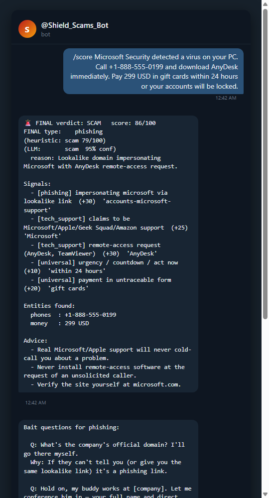
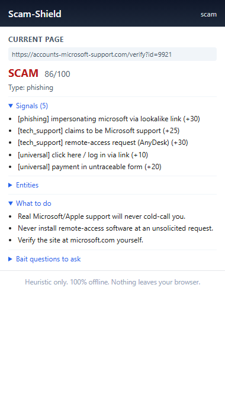

# scam-shield

> Fool-proof scam detection and counter-engagement. Pure-Python, works offline,
> ships with a Chrome extension and a Telegram bot.

[](https://github.com/Honcho92/scam-shield/actions/workflows/tests.yml)
[](https://github.com/Honcho92/scam-shield/actions/workflows/js-parity.yml)
[](https://www.python.org/downloads/)
[](#tests)
[](LICENSE)
[](#design)

`scam-shield` is a local-first toolkit for spotting, scoring, and reporting
scams. It runs entirely on your machine — no data leaves unless you wire up
the optional Telegram bot or local Ollama second opinion.

## See it in action

| Telegram bot reply | Chrome extension popup |
|:------------------:|:----------------------:|
|  |  |

The Telegram bot on the left scored a phishing message in 1.3s using both the
heuristic engine and a local Ollama LLM. The Chrome extension on the right
flagged a lookalike Microsoft domain before the user typed anything.

## What it does

| Layer | What | Where |
|------:|------|------|
| **Question Playbook** | 35+ bait questions, hand-tuned by scam type, with rationale | phone, anywhere |
| **Detector** | Heuristic scorer (0-100) + verdict + entity extraction | CLI / Python |
| **LLM Judge** | Local Ollama second opinion (~1.3s, optional) | CLI / Python |
| **Honeypot** | Auto-reply persona that wastes a scammer's time, logs evidence | CLI / Telegram |
| **Telegram bot** | All of the above, on your phone | phone |
| **`/quiet` mode** | One-line replies, "forward and forget" | Telegram bot |
| **Agent loop** | Background watcher — auto-files report packs, sends DMs | cron / scheduled |
| **Weekly digest** | Sunday-night summary DM of the week's activity | cron |
| **Chrome extension** | Scores every page you load, offline, badge on toolbar | browser |
| **Report pack** | Auto-generates 9 files ready to file with FTC/IC3/bank/platform | CLI / Telegram |
| **History DB** | SQLite of every report, full-text search, stats | CLI |

Zero external Python dependencies. Ollama is the only optional external service
(for the LLM judge). The Chrome extension uses no npm packages.

## Quick start

### Install

```bash
git clone https://github.com/Honcho92/scam-shield
cd scam-shield

# optional: install as a package so `python -m scam_shield` works from anywhere
python -m pip install -e .
```

### Try the demo

```bash
PYTHONPATH=. python -m scam_shield demo
```

You should see 7 known scam messages scoring 50+ and 2 legitimate messages
scoring 0.

### Score a message you got

```bash
PYTHONPATH=. python -m scam_shield analyze "URGENT: Microsoft Security has detected a virus. Call +1-888-555-0199 and download AnyDesk immediately. Pay 299 USD in gift cards."
```

You'll get a verdict, score, scam type, every signal that contributed,
phones / emails / URLs / money asks found, and tailored advice.

### Generate an FTC-ready report pack

```bash
PYTHONPATH=. python -m scam_shield report "PASTE THE MESSAGE" --out ./my-case
```

This writes 9 files (FTC complaint narrative, bank notice, platform abuse
report, law-enforcement JSON, filing checklist, etc.) ready to copy/paste
into ReportFraud.ftc.gov.

### Run the Telegram bot

```bash
export TELEGRAM_BOT_TOKEN=...        # get one from @BotFather
export SCAMSHIELD_LLM=on            # optional, enables Ollama second opinion
PYTHONPATH=. python -m scam_shield.telegram_bot
```

Forward any suspicious text/email to the bot. Get a verdict, playbook, and
optional honeypot counter-conversation.

### Install the Chrome extension

1. Open `chrome://extensions`
2. Toggle **Developer mode** on
3. Click **Load unpacked**, select the `chrome-extension/` folder
4. Pin the Scam-Shield icon to your toolbar

Every page you load gets scored. If the page triggers `suspicious` or worse,
the toolbar icon shows a colored badge. Click for full details.

## Design

The detector is **transparent**: every signal is exposed with the snippet
that triggered it, the weight it contributed, and the scam type it implies.
There is no black-box score. You can read `scam_shield/detector.py` and
understand every decision.

The pattern bank at the top of `detector.py` is data — tuples of
`(scam_type, category, weight, compiled_regex)`. Adding a new pattern is
one line. Removing a false-positive pattern is one line.

The agent loop and the Telegram bot share a single source of truth: the
SQLite history DB. The bot writes reports; the agent picks them up, runs
the full pipeline, and acts on them. Both can run independently.

## Verdict buckets

| Score    | Verdict        | What to do                                            |
|----------|----------------|-------------------------------------------------------|
| 0-24     | clean          | Probably fine. Stay alert.                            |
| 25-49    | suspicious     | Slow down. Verify before acting.                      |
| 50-74    | likely_scam    | Don't engage. Report.                                 |
| 75+      | scam           | Block, report, optionally engage with the playbook.   |

## Tests

```bash
PYTHONPATH=. python -m unittest discover -s tests
```

88 tests pass: 21 detector / playbook / honeypot, 14 telegram bot commands,
17 LLM judge + full pipeline, 11 report pack, 9 history, 1 JS-Python parity
test, 17 agent loop / digest / bot-agent integration. Plus 1 smoke test for
the no-token bot startup path.

## Layout

```
scam_shield/             # 9 Python modules (detector, playbook, honeypot,
                         #   llm_judge, report_pack, history, agent_loop,
                         #   digest, telegram_bot, cli)
chrome-extension/        # Manifest V3 extension, vanilla JS, no frameworks
tests/                   # 8 test files, 88 passing
docs/                    # Screenshots for the README + HTML mockups
OPERATOR_GUIDE.md        # One-page reference for every layer
setup_scheduler.ps1      # One-time Windows Task Scheduler setup
make_icons.py            # Regenerate Chrome extension icons (stdlib only)
LICENSE                  # MIT
```

## Agent loop (the "AI in the background" piece)

```bash
# one-shot
PYTHONPATH=. python -m scam_shield.agent_loop

# forever, polling every 60s
PYTHONPATH=. python -m scam_shield.agent_loop --watch --interval 60
```

For `scam` and `likely_scam` verdicts: auto-generates a report pack to
`~/.scam-shield/reports/auto-<ts>-<case>/` and DMs you a one-liner through
the bot. For `suspicious`: DMs you a one-liner. For `clean`: logs only.

To get Telegram DMs from the agent, set `SCAMSHIELD_NOTIFY_CHAT_ID` to your
chat id (forward any message to `@userinfobot` on Telegram to find yours).

## Weekly digest

```bash
PYTHONPATH=. python -m scam_shield.digest --send
```

Ships a summary of the past 7 days (or any window via `--days N`) through
your bot. Counts by verdict, top scam types, top phones/emails/URLs, worst
offenders.

## Auto-schedule on Windows

```powershell
# Run once as Administrator
.\setup_scheduler.ps1
```

Creates two Windows scheduled tasks:
- **ScamShield Agent** — every 5 minutes, processes unprocessed reports
- **ScamShield Digest** — Sunday 8pm, sends the weekly digest

## Privacy

Everything is local. The detector never contacts the URLs, emails, or phone
numbers it finds. The only network calls that ever happen are:
- (optional) HTTP to your local Ollama for the LLM judge
- (optional) HTTPS to `api.telegram.org` if you wire up the bot

You can audit the entire codebase in one sitting — it's ~3000 lines of pure
Python and ~600 lines of vanilla JS.

## Contributing

PRs welcome. Add new patterns to `scAM_PATTERNS` at the top of
`scam_shield/detector.py`, then add a test case to
`tests/test_scam_shield.py`. Run the suite, make sure all 88 still pass.

For the Chrome extension, mirror the same patterns to
`chrome-extension/detector.js`. The `tests/test_js_parity.py` test catches
drift between the two.

## License

MIT — see [LICENSE](LICENSE).

## Disclaimer

This tool helps you recognize scams. It is not a substitute for judgment,
legal advice, or reporting to actual authorities. The pattern bank will not
catch every scam — clever ones will slip through. If something feels wrong,
trust your gut and verify through an independent channel.
